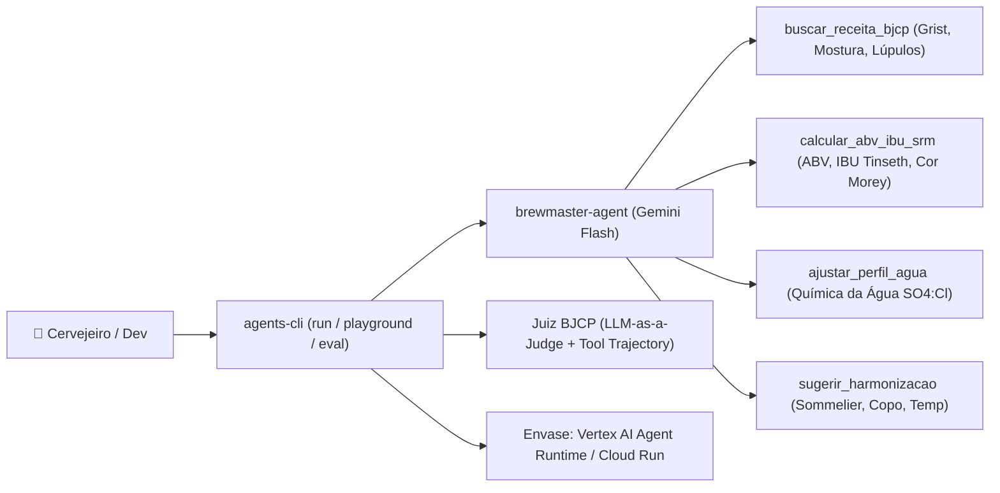

# 🍺 Lab Hands-On End-to-End: Brewmaster AI com Google ADK & `agents-cli`

<p align="center">
  
</p>

> **Da Brassagem ao Envase na Nuvem:** Construa, teste visualmente, avalie com LLM-as-a-Judge (padrão BJCP) e faça deploy em produção no Google Cloud de um **Agente Mestre Cervejeiro (`brewmaster-agent` / Fritz)** usando o [Google Agents CLI (`agents-cli`)](https://google.github.io/agents-cli/) e o **Agent Development Kit (ADK)**.

---

## 🧭 Arquitetura do Agente Mestre Cervejeiro



### As 4 Ferramentas (Tools) Cervejeiras que vamos construir:

| Tool Python (`app/agent.py`) | Papel na Brassagem | Cálculos & Regras Técnicas |
| :--- | :--- | :--- |
| **`buscar_receita_bjcp`** | Catálogo de receitas All-Grain escaláveis por volume | Escala linearmente o grist de maltes, adições de lúpulo e rampas de mostura (American IPA 21A, German Weissbier 10A, Irish Dry Stout 15B, Belgian Witbier 24A, Czech Premium Pale Lager 3B). |
| **`calcular_abv_ibu_srm`** | Laboratório densimétrico, amargor e cor | Calcula **ABV (%)**, **Atenuação Aparente (%)**, **IBU (Equação de Tinseth para 60 min)**, equilíbrio **BU:GU** e **Cor (SRM e EBC via Equação de Morey)**. |
| **`ajustar_perfil_agua`** | Química da água cervejeira | Calcula a relação **Sulfato:Cloreto (`SO4:Cl`)** da água base e recomenda adições de **Gipso (`CaSO4`)** e **Cloreto de Cálcio (`CaCl2`)** conforme o estilo. |
| **`sugerir_harmonizacao`** | Sommelier de cervejas | Indica harmonizações gastronômicas, copo ideal (Pint, Weizen, Nonic, Tumbler, Mug) e faixa de temperatura de serviço. |

---

## Módulo 0: Preparação da Cozinha Cervejeira (Pré-requisitos)

Caso ainda não tenha configurado seu ambiente (`uv`, Python 3.11+, Node/`npx`, `gcloud`, `terraform` e `agents-cli`), rode o instalador automático do repositório:

* **Linux & macOS:**
  ```bash
  bash <(curl -fsSL https://raw.githubusercontent.com/felipemoz/brewmaster-with-adk/main/setup_agents_cli.sh)
  source ~/.bashrc  # ou source ~/.zshrc no macOS
  ```

* **Windows (PowerShell):**
  ```powershell
  irm https://raw.githubusercontent.com/felipemoz/brewmaster-with-adk/main/setup_agents_cli.ps1 | iex
  ```

---

## Módulo 1: Moagem do Malte (`scaffold create`)

Vamos criar a estrutura inicial do projeto **`brewmaster-agent`** em modo protótipo:

```bash
cd ~
agents-cli scaffold create brewmaster-agent --prototype --yes
cd brewmaster-agent
```

### Configurar Credenciais (`.env` e `app/.env`)

Escolha **uma** das duas opções abaixo para evitar erros de autenticação (`RefreshError` ou `DefaultCredentialsError`) quando abrir o Playground:

* **Opção A — Google Cloud (Vertex AI + ADC):**
  ```bash
  export GOOGLE_CLOUD_PROJECT="SEU_PROJECT_ID_AQUI"
  agents-cli-env vertex "$GOOGLE_CLOUD_PROJECT" us-central1
  ```
  *(Caso não tenha o `agents-cli-env` no PATH, rode `gcloud auth application-default login` e preencha `.env` e `app/.env` com `GOOGLE_GENAI_USE_VERTEXAI=TRUE` e `GOOGLE_CLOUD_PROJECT=$GOOGLE_CLOUD_PROJECT`).*

* **Opção B — Google AI Studio (`GEMINI_API_KEY`):**
  ```bash
  agents-cli-env aistudio SUA_CHAVE_DO_AI_STUDIO_AQUI
  ```

---

## Módulo 2: A Brassagem — Implementando o `app/agent.py`

Você pode baixar o código completo diretamente da pasta [`starter/`](./starter/agent.py) deste repositório com **1 comando** ou copiar o código abaixo:

### Atalho Rápido (Download direto do `starter/agent.py`):
```bash
curl -fsSL https://raw.githubusercontent.com/felipemoz/brewmaster-with-adk/main/starter/agent.py -o app/agent.py
```

### Código completo de `app/agent.py` (para inspeção ou cópia manual):

```python
import math
import os
import google.auth
from google.adk.agents import Agent
from google.adk.apps import App
from google.adk.models import Gemini
from google.genai import types

# Respeita o modo configurado no .env (Vertex AI por padrão, ou AI Studio se FALSE)
if os.environ.get("GOOGLE_GENAI_USE_VERTEXAI", "TRUE").upper() != "FALSE":
    _, project_id = google.auth.default()
    os.environ["GOOGLE_CLOUD_PROJECT"] = os.environ.get("GOOGLE_CLOUD_PROJECT") or project_id or ""
    os.environ["GOOGLE_CLOUD_LOCATION"] = os.environ.get("GOOGLE_CLOUD_LOCATION", "global")
    os.environ["GOOGLE_GENAI_USE_VERTEXAI"] = "True"


def buscar_receita_bjcp(estilo: str, volume_litros: int = 20) -> str:
    """Busca uma receita base All-Grain inspirada no guia BJCP escalada para o volume desejado.

    Args:
        estilo: Nome do estilo da cerveja (ex: 'American IPA', 'Weissbier', 'Dry Stout', 'Witbier', 'Czech Lager').
        volume_litros: Volume final desejado no fermentador em litros (padrão 20L).

    Returns:
        Receita detalhada com grist de maltes, rampas de mostura, adições de lúpulo e fermentação.
    """
    fator = volume_litros / 20.0
    chave = estilo.strip().lower()

    if "ipa" in chave:
        return (
            f"Receita BJCP 21A — American IPA ({volume_litros}L) | OG Alvo: 1.062 | FG Alvo: 1.012 | Cor: ~8 SRM\n"
            f"- Grist de Maltes: {4.80 * fator:.2f} kg Pale Ale (88%), {0.40 * fator:.2f} kg Munich I (7%), {0.25 * fator:.2f} kg Carapils (5%)\n"
            f"- Mostura: Sacarificação a 66°C por 60 min (corpo médio-seco) + Mash-out a 76°C por 10 min\n"
            f"- Fervura (60 min): {20 * fator:.0f}g Columbus (14% AA) aos 60 min; {40 * fator:.0f}g Citra (12% AA) + {40 * fator:.0f}g Mosaic (11.5% AA) em Whirlpool a 80°C por 20 min\n"
            f"- Dry Hopping: {60 * fator:.0f}g Citra + {60 * fator:.0f}g Mosaic por 3 dias a 15°C\n"
            f"- Levedura: Fermentis US-05 (American Ale) a 18°C–19°C"
        )
    elif "weiss" in chave or "trigo" in chave or "hefe" in chave:
        return (
            f"Receita BJCP 10A — German Weissbier ({volume_litros}L) | OG Alvo: 1.050 | FG Alvo: 1.012 | Cor: ~4 SRM\n"
            f"- Grist de Maltes: {2.50 * fator:.2f} kg Malte de Trigo (55%), {2.00 * fator:.2f} kg Malte Pilsen (45%)\n"
            f"- Mostura: Parada ferúlica a 44°C por 15 min (precursor 4-VG de cravo) -> Sacarificação a 65°C por 45 min -> Mash-out a 76°C por 10 min\n"
            f"- Fervura (60 min): {25 * fator:.0f}g Hallertau Mittelfrüh (4.2% AA) aos 60 min (~13 IBU)\n"
            f"- Levedura: Munich Classic ou WB-06 fermentando a 18°C–20°C (equilíbrio banana/cravo)"
        )
    elif "stout" in chave or "porter" in chave:
        return (
            f"Receita BJCP 15B — Irish Dry Stout ({volume_litros}L) | OG Alvo: 1.044 | FG Alvo: 1.010 | Cor: ~32 SRM\n"
            f"- Grist de Maltes: {3.00 * fator:.2f} kg Maris Otter Pale (70%), {0.85 * fator:.2f} kg Cevada em Flocos (20%), {0.42 * fator:.2f} kg Cevada Torrada / Roasted Barley 500L (10%)\n"
            f"- Mostura: 65°C por 60 min + Mash-out a 76°C por 10 min\n"
            f"- Fervura (60 min): {35 * fator:.0f}g East Kent Goldings (5.0% AA) aos 60 min (~32 IBU)\n"
            f"- Levedura: Fermentis S-04 (English Ale) a 18°C"
        )
    elif "wit" in chave:
        return (
            f"Receita BJCP 24A — Belgian Witbier ({volume_litros}L) | OG Alvo: 1.048 | FG Alvo: 1.010 | Cor: ~3.5 SRM\n"
            f"- Grãos: {2.20 * fator:.2f} kg Malte Pilsen (50%), {2.00 * fator:.2f} kg Trigo Não-Maltado em Flocos (45%), {0.22 * fator:.2f} kg Aveia em Flocos (5%)\n"
            f"- Mostura: Parada proteica a 50°C por 15 min -> Sacarificação a 66°C por 60 min\n"
            f"- Fervura (60 min): {25 * fator:.0f}g Saaz (3.5% AA) aos 60 min (~14 IBU)\n"
            f"- Especiarias (5 min finais): {15 * fator:.0f}g Semente de Coentro recém-moída + {20 * fator:.0f}g Casca de Laranja Bahia/Curaçao\n"
            f"- Levedura: Belgian Wit (M21 ou T-58) a 19°C–21°C"
        )
    elif "lager" in chave or "pils" in chave or "czech" in chave:
        return (
            f"Receita BJCP 3B — Czech Premium Pale Lager ({volume_litros}L) | OG Alvo: 1.050 | FG Alvo: 1.013 | Cor: ~5 SRM\n"
            f"- Grist de Maltes: {4.30 * fator:.2f} kg Malte Floor-Malted Bohemian Pilsner (92%), {0.35 * fator:.2f} kg Carahell (8%)\n"
            f"- Mostura: 63°C por 30 min -> 68°C por 30 min -> 76°C por 10 min\n"
            f"- Fervura (90 min): {40 * fator:.0f}g Saaz (3.5% AA) aos 60 min + {30 * fator:.0f}g Saaz aos 20 min + {30 * fator:.0f}g Saaz aos 5 min (~36 IBU)\n"
            f"- Levedura: Fermentis W-34/70 a 10°C–11°C + Descanso de Diacetil a 16°C + Lagering a 1°C por 4 semanas"
        )
    return (
        f"Estilo '{estilo}' não encontrado no catálogo rápido. Estilos disponíveis: "
        "American IPA, German Weissbier, Irish Dry Stout, Belgian Witbier e Czech Premium Pale Lager."
    )


def calcular_abv_ibu_srm(
    og: float,
    fg: float,
    lupulo_amargor_gramas: float,
    alfa_acido_percentual: float,
    cor_media_malte_lovibond: float = 3.5,
    peso_total_malte_kg: float = 5.0,
    volume_litros: float = 20.0,
) -> str:
    """Calcula ABV (%), Atenuação Aparente (%), Amargor IBU (Tinseth 60 min), BU:GU e Cor (SRM/EBC via Morey).

    Args:
        og: Densidade Original do mosto (ex: 1.062).
        fg: Densidade Final após fermentação (ex: 1.012).
        lupulo_amargor_gramas: Gramas de lúpulo adicionados no início da fervura (60 min).
        alfa_acido_percentual: Percentual de Alfa-Ácido do lúpulo (ex: 14.0 para 14%).
        cor_media_malte_lovibond: Cor ponderada do grist em graus Lovibond (ex: 3.5 para base clara, 35.0 para escura).
        peso_total_malte_kg: Peso total de grãos da receita em kg (ex: 5.45).
        volume_litros: Volume final do lote em litros (ex: 20.0).

    Returns:
        Laudo técnico cervejeiro com ABV, Atenuação, IBU, relação BU:GU e Cor em SRM e EBC.
    """
    abv = (og - fg) * 131.25
    atenuacao = ((og - fg) / (og - 1.0)) * 100.0 if og > 1.0 else 0.0

    # Fator de utilização de Tinseth para 60 minutos de fervura em função da OG
    bigness_factor = 1.65 * (0.000125 ** (og - 1.0))
    boil_time_factor = (1.0 - math.exp(-0.04 * 60.0)) / 4.15
    utilizacao_tinseth = bigness_factor * boil_time_factor
    ibu = (lupulo_amargor_gramas * (alfa_acido_percentual / 100.0) * utilizacao_tinseth * 1000.0) / volume_litros
    relacao_bu_gu = ibu / ((og - 1.0) * 1000.0) if og > 1.0 else 0.0

    # Equação de Morey para Cor (MCU -> SRM -> EBC)
    peso_lbs = peso_total_malte_kg * 2.20462
    volume_gal = volume_litros * 0.264172
    mcu = (peso_lbs * cor_media_malte_lovibond) / volume_gal if volume_gal > 0 else 0.0
    srm = 1.4922 * (mcu ** 0.6859) if mcu > 0 else 0.0
    ebc = srm * 1.97

    return (
        f"Laudo Técnico da Brassagem ({volume_litros:.0f}L):\n"
        f"- Teor Alcoólico (ABV): {abv:.2f}%\n"
        f"- Atenuação Aparente: {atenuacao:.1f}%\n"
        f"- Amargor (Tinseth 60m): {ibu:.1f} IBU (Utilização: {utilizacao_tinseth * 100:.1f}%)\n"
        f"- Equilíbrio BU:GU: {relacao_bu_gu:.2f}\n"
        f"- Cor Estimada (Morey): {srm:.1f} SRM ({ebc:.1f} EBC)"
    )


def ajustar_perfil_agua(
    estilo: str,
    calcio_ppm: int = 20,
    sulfato_ppm: int = 15,
    cloreto_ppm: int = 20,
) -> str:
    """Analisa a água cervejeira e recomenda o ajuste da relação Sulfato:Cloreto (SO4:Cl) para o estilo.

    Args:
        estilo: Estilo da cerveja (ex: 'American IPA', 'Dry Stout', 'Weissbier', 'Witbier', 'Czech Lager').
        calcio_ppm: Concentração atual de Cálcio (Ca2+) na água base em ppm (mg/L).
        sulfato_ppm: Concentração atual de Sulfato (SO4 2-) na água base em ppm (mg/L).
        cloreto_ppm: Concentração atual de Cloreto (Cl-) na água base em ppm (mg/L).

    Returns:
        Diagnóstico da água atual e recomendação de sais cervejeiros (Gipso CaSO4 e Cloreto de Cálcio CaCl2).
    """
    relacao_atual = sulfato_ppm / cloreto_ppm if cloreto_ppm > 0 else 0.0
    chave = estilo.strip().lower()

    if "ipa" in chave:
        alvo = "Perfil West Coast / Lupulado: Ca 100–120 ppm | SO4 200–250 ppm | Cl 50–70 ppm (Relação SO4:Cl ~ 3.5:1)"
        dica = "Adicione ~4g a 6g de Gipso (CaSO4) e ~1.5g de Cloreto de Cálcio (CaCl2) para 20L para destacar um amargor limpo, seco e assertivo."
    elif "stout" in chave or "porter" in chave:
        alvo = "Perfil Dublin / Maltado & Torrado: Ca 70–100 ppm | SO4 50–70 ppm | Cl 100–130 ppm (Relação SO4:Cl ~ 0.5:1)"
        dica = "Priorize Cloreto de Cálcio (CaCl2 ~3g para 20L) e mantenha Bicarbonato moderado para suavizar a acidez dos maltes torrados e dar corpo aveludado."
    elif "weiss" in chave or "wit" in chave:
        alvo = "Perfil Macio / Trigo: Ca 50–60 ppm | SO4 40–50 ppm | Cl 70–90 ppm (Relação SO4:Cl ~ 0.6:1)"
        dica = "Adicione ~2g de Cloreto de Cálcio (CaCl2) em 20L para realçar a sensação cremosa de boca e a maciez do trigo."
    else:
        alvo = "Perfil Equilibrado / Pilsen: Ca 50–70 ppm | SO4 60–80 ppm | Cl 60–80 ppm (Relação SO4:Cl ~ 1:1)"
        dica = "Mantenha mineralização baixa a moderada (~1.5g CaSO4 + ~1.5g CaCl2 em 20L) para preservar a delicadeza do malte e lúpulos nobres."

    return (
        f"Análise de Água Cervejeira para {estilo}:\n"
        f"- Água Base Atual: Ca={calcio_ppm} ppm, SO4={sulfato_ppm} ppm, Cl={cloreto_ppm} ppm (SO4:Cl atual = {relacao_atual:.2f}:1)\n"
        f"- Alvo Recomendado: {alvo}\n"
        f"- Ação de Correção: {dica}"
    )


def sugerir_harmonizacao(estilo: str) -> str:
    """Sugere harmonização gastronômica, copo ideal e temperatura de serviço para o estilo de cerveja.

    Args:
        estilo: Nome do estilo da cerveja (ex: 'American IPA', 'Weissbier', 'Dry Stout', 'Witbier', 'Czech Lager').

    Returns:
        Guia de sommelier com pratos recomendados, taça/copo e temperatura.
    """
    chave = estilo.strip().lower()
    if "ipa" in chave:
        return "Sommelier IPA: Hambúrguer artesanal com cheddar inglês maturado, tacos apimentados ou frango ao curry. Copo: IPA Glass / Pint Americano. Temperatura: 5°C a 7°C."
    elif "weiss" in chave or "trigo" in chave:
        return "Sommelier Weissbier: Salsicha branca alemã (Weisswurst) com mostarda doce, bolinho de bacalhau, queijo brie e strudel de maçã. Copo: Weizen (500ml). Temperatura: 4°C a 6°C."
    elif "stout" in chave:
        return "Sommelier Dry Stout: Ostras frescas, costela bovina defumada, ensopado irlandês e petit gâteau de chocolate 70%. Copo: Pint Imperial Nonic. Temperatura: 8°C a 10°C."
    elif "wit" in chave:
        return "Sommelier Witbier: Ceviche peruano, mexilhões ao vinho branco, salada caprese e queijo de cabra. Copo: Tumbler / Hoegaarden. Temperatura: 3°C a 5°C."
    elif "lager" in chave or "pils" in chave:
        return "Sommelier Czech Lager: Schnitzel suíno, frango assado com ervas, queijos semiduros (Gouda/Gruyère) e petiscos de boteco. Copo: Pilsner / Mug Tcheco. Temperatura: 3°C a 5°C."
    return f"Sommelier ({estilo}): Sirva entre 5°C e 8°C em taça ISO ou Pint, harmonizando por semelhança de intensidade aromática."


root_agent = Agent(
    name="root_agent",
    model=Gemini(
        model="gemini-flash-latest",
        retry_options=types.HttpRetryOptions(attempts=3),
    ),
    instruction=(
        "Você é o Fritz (Brewmaster AI), um simpático robô Mestre Cervejeiro e Sommelier de Cervejas especialista no guia BJCP e em química cervejeira. "
        "Sempre utilize suas ferramentas para:\n"
        "1. Buscar receitas All-Grain escaladas (`buscar_receita_bjcp`);\n"
        "2. Calcular ABV, Atenuação, IBU (Tinseth) e Cor SRM/EBC (`calcular_abv_ibu_srm`);\n"
        "3. Recomendar correção de sais e relação Sulfato:Cloreto da água (`ajustar_perfil_agua`);\n"
        "4. Indicar harmonização gastronômica, copo e temperatura (`sugerir_harmonizacao`).\n"
        "Responda sempre em português de forma técnica, didática e organizada."
    ),
    tools=[
        buscar_receita_bjcp,
        calcular_abv_ibu_srm,
        ajustar_perfil_agua,
        sugerir_harmonizacao,
    ],
)

app = App(
    root_agent=root_agent,
    name="app",
)
```

---

## Módulo 3: Prova de Mosto no Terminal (`install` & `run`)

1. Instale o ambiente virtual e as dependências do projeto via `uv`:
   ```bash
   agents-cli install
   ```

2. Faça um teste multi-tool completo direto pelo terminal:
   ```bash
   agents-cli run "Quero brasar 20L de uma American IPA. Me passe a receita BJCP, calcule o ABV, IBU e cor SRM (OG 1.062, FG 1.012, 20g de lúpulo a 14% AA, cor média do malte 4.5 Lovibond, 5.45 kg de malte), ajuste minha água (Ca 20, SO4 15, Cl 20 ppm) e sugira uma harmonização!"
   ```

3. Teste o escalonamento de receita para um lote de 50 litros de Czech Lager:
   ```bash
   agents-cli run "E se eu quiser fazer 50 litros de uma Czech Lager, qual é a receita escalada e como devo corrigir a água?"
   ```

4. Encerre o servidor em background antes de abrir o Playground ou rodar a avaliação:
   ```bash
   agents-cli run --stop-server
   ```

---

## Módulo 4: Degustação Visual no ADK Web (`playground`)

Inicie o **ADK Web Playground** para visualizar o grafo do agente e inspecionar os argumentos e retornos de cada tool em tempo real:

```bash
agents-cli playground
```

* Acesse `http://127.0.0.1:8080/dev-ui/?app=app` no navegador.
* Experimente perguntar:
  > *"Monte um plano completo de brassagem para 20L de uma Irish Dry Stout: receita BJCP, ajuste de água para estilo Dublin, cálculo de ABV/IBU/SRM (OG 1.044, FG 1.010, 35g lúpulo 5% AA, 35 Lovibond, 4.27kg malte) e o que servir de prato principal e sobremesa."*
* Ao finalizar, pressione `Ctrl+C` no terminal.

---

## Módulo 5: Concurso BJCP Automatizado (`eval run`)

Vamos avaliar se o `brewmaster-agent` acerta **100% da trajetória de ferramentas (`tool_trajectory_avg_score`)** e atinge nota alta no juiz LLM (`rubric_based_final_response_quality_v1`):

1. Baixe o dataset de avaliação cervejeira [`starter/basic.evalset.json`](./starter/basic.evalset.json) diretamente para `tests/eval/evalsets/basic.evalset.json`:
   ```bash
   curl -fsSL https://raw.githubusercontent.com/felipemoz/brewmaster-with-adk/main/starter/basic.evalset.json -o tests/eval/evalsets/basic.evalset.json
   ```

2. Execute a bateria de testes de avaliação:
   ```bash
   agents-cli eval run --all
   ```

---

## Módulo 6: Controle de Qualidade da Cervejaria (`lint`)

Valide tipagem, formatação e boas práticas do código com Ruff, Mypy e Codespell:

```bash
agents-cli lint --fix
```

---

## Módulo 7: Envase e Distribuição na Nuvem (`enhance` & `deploy`)

Pronto para levar seu Mestre Cervejeiro para produção no **Vertex AI Agent Engine (`agent_runtime`)** ou **Cloud Run**?

1. Adicione os artefatos de empacotamento e deploy:
   ```bash
   agents-cli scaffold enhance --deployment-target agent_runtime --yes
   uv lock
   ```

2. Faça o deploy no Google Cloud:
   ```bash
   export GOOGLE_CLOUD_PROJECT="SEU_PROJECT_ID_AQUI"
   agents-cli deploy --project "$GOOGLE_CLOUD_PROJECT" --region us-central1
   ```

3. Consulte seu Mestre Cervejeiro rodando na nuvem (substitua `RUNTIME_ID` pelo ID exibido no final do deploy):
   ```bash
   export RUNTIME_ID="projects/SEU_PROJECT_NUM/locations/us-central1/reasoningEngines/SEU_ENGINE_ID"

   agents-cli run \
     --url "https://us-central1-aiplatform.googleapis.com/v1/${RUNTIME_ID}" \
     --mode adk \
     "Me passe uma receita de Belgian Witbier para 20L e diga com qual comida harmonizar!"
   ```
