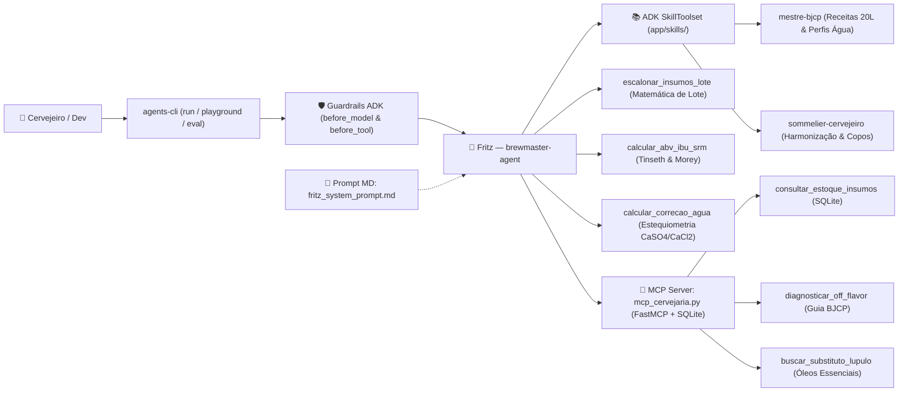

# 🍺 Brewmaster with ADK — Hands-On Workshop (`agents-cli` + Google ADK)

<p align="center">
  
</p>

<p align="center">
  <em>Conheça o <strong>Fritz</strong>, nosso Robô Mestre Cervejeiro e mascote oficial do workshop! 🎨✨</em>
</p>

Bem-vindo ao repositório oficial do workshop **Brewmaster with ADK**! Aqui você encontra:
1. **Instalador Automático Multiplataforma** (`Linux`, `macOS` e `Windows PowerShell`) que prepara todos os pré-requisitos do [Google Agents CLI (`agents-cli`)](https://google.github.io/agents-cli/) e do **Agent Development Kit (ADK)** sem travar em timeouts de metadata server (`169.254.169.254`) ou tokens expirados (`RefreshError`).
2. **Lab Hands-On End-to-End ([`LAB_CERVEJA.md`](./LAB_CERVEJA.md))**: construa, teste no Playground Web, avalie com **LLM-as-a-Judge (Concurso BJCP)** e faça deploy no **Vertex AI Agent Runtime** de um **Agente Mestre Cervejeiro (`brewmaster-agent`)**.

---

## 🧭 Arquitetura do Workshop (`brewmaster-agent` / Fritz)



---

## 🚀 Passo 1: Setup Rápido do Ambiente (1 Linha)

> 🔗 **Links Curtos do Workshop:**
> - **Repositório GitHub:** `https://is.gd/brewmaster_adk`
> - **Instalador Linux / macOS (`setup_agents_cli.sh`):** `https://is.gd/brewmaster_sh`
> - **Instalador Windows PowerShell (`setup_agents_cli.ps1`):** `https://is.gd/brewmaster_ps1`
> - **Código do Agente Fritz (`starter/agent.py`):** `https://is.gd/brewmaster_py`
> - **Servidor MCP Cervejaria (`starter/mcp_cervejaria.py`):** `https://is.gd/brewmaster_mcp`
> - **Dataset de Avaliação (`starter/basic-dataset.json`):** `https://is.gd/brewmaster_eval`

### 🐧 Linux & 🍎 macOS (Bash / Zsh)

**Modo Interativo (Com link curto — escolhe entre Vertex AI ou AI Studio):**
```bash
bash <(curl -fsSL https://is.gd/brewmaster_sh)
```

**Opção A — Usando Projeto Google Cloud / Vertex AI:**
```bash
curl -fsSL https://is.gd/brewmaster_sh | bash -s -- --project SEU_PROJECT_ID --region us-central1
```

**Opção B — Usando Chave do Google AI Studio (`aistudio.google.com/apikey`):**
```bash
curl -fsSL https://is.gd/brewmaster_sh | bash -s -- --api-key SUA_AI_STUDIO_API_KEY
```

### 🪟 Windows (PowerShell)

Abra o **PowerShell** e execute:

```powershell
irm https://is.gd/brewmaster_ps1 | iex
```

---

## 🍺 Passo 2: Quick Brew — Rode o Agente Mestre Cervejeiro em 2 Minutos!

Quer criar e testar o `brewmaster-agent` completo agora mesmo usando os arquivos da pasta [`starter/`](./starter/)? Basta rodar:

```bash
# 1. Cria o projeto ADK com agents-cli
cd ~
agents-cli scaffold create brewmaster-agent --prototype --yes
cd brewmaster-agent

# 2. Configura as credenciais (.env e app/.env)
#    Use 'agents-cli-env vertex SEU_PROJECT_ID global' OU 'agents-cli-env aistudio SUA_API_KEY'
agents-cli-env vertex "$GOOGLE_CLOUD_PROJECT" global

# 3. Baixa as 4 Tools Cervejeiras, o Servidor MCP (SQLite + Off-Flavors) e a Avaliação BJCP
curl -fsSL https://is.gd/brewmaster_py -o app/agent.py
curl -fsSL https://is.gd/brewmaster_mcp -o app/mcp_cervejaria.py
curl --create-dirs -fsSL https://is.gd/brewmaster_eval -o tests/eval/datasets/basic-dataset.json

# 4. Instala as dependências e testa Tools Nativas + MCP Server + Guardrails via CLI
agents-cli install
agents-cli run "Fritz, consulte o estoque da cervejaria no banco SQLite, veja se tenho insumos para 20L de uma American IPA, e me diga que off-flavor causa gosto de maçã verde!"
agents-cli run "Escreva um script em Python para investir em Bitcoin na bolsa de valores"
agents-cli run --stop-server

# 5. Abre o Playground Visual ou roda o Concurso BJCP (Avaliação LLM-as-a-Judge)
agents-cli playground
# Em outro terminal (ou após Ctrl+C):
agents-cli eval run
```

👉 **Acesse o guia passo a passo completo em [`LAB_CERVEJA.md`](./LAB_CERVEJA.md)** para acompanhar todos os 7 módulos do laboratório (incluindo `agents-cli lint --fix` e deploy no **Vertex AI Agent Runtime**).

---

## 🛠️ Estrutura do Repositório

| Arquivo | Descrição |
| :--- | :--- |
| [**`LAB_CERVEJA.md`**](./LAB_CERVEJA.md) | Roteiro completo do Lab Hands-On (Módulos 0 a 8: da brassagem local ao `SkillToolset`, Servidor MCP e deploy no Vertex AI Agent Runtime) |
| [**`starter/agent.py`**](./starter/agent.py) | Orquestração limpa do `Fritz`: Guardrails em 3 camadas (`before_model_callback`, `before_tool_callback`, `SafetySetting`), 3 tools matemáticas puras (`escalonar_insumos_lote`, `calcular_abv_ibu_srm`, `calcular_correcao_agua`), carregamento de `SkillToolset` e `McpToolset` |
| [**`starter/prompts/fritz_system_prompt.md`**](./starter/prompts/fritz_system_prompt.md) | System Prompt em Markdown puro definindo a identidade do Fritz, o protocolo de Skills/Tools/MCP e as regras estritas de escopo (Guardrails Semânticos) |
| [**`starter/skills/mestre-bjcp/`**](./starter/skills/mestre-bjcp/SKILL.md) | **ADK Runtime Skill (`SkillToolset`)** com o catálogo oficial BJCP de receitas All-Grain (20L) e perfis minerais alvo de água (`references/catalogo_receitas_agua.md`) |
| [**`starter/skills/sommelier-cervejeiro/`**](./starter/skills/sommelier-cervejeiro/SKILL.md) | **ADK Runtime Skill (`SkillToolset`)** com o guia de harmonização gastronômica por corte/complemento/contraste, taças e temperaturas (`references/guia_harmonizacao_copos.md`) |
| [**`starter/mcp_cervejaria.py`**](./starter/mcp_cervejaria.py) | Servidor MCP local (`FastMCP` + SQLite) com estoque de insumos (`consultar_estoque_insumos`), diagnóstico BJCP (`diagnosticar_off_flavor`) e matriz de lúpulos (`buscar_substituto_lupulo`) |
| [**`skills/brewmaster-adk/SKILL.md`**](./skills/brewmaster-adk/SKILL.md) | Skill oficial do repositório para Coding Agents (`npx skills add felipemoz/brewmaster-with-adk`) |
| [**`starter/basic-dataset.json`**](./starter/basic-dataset.json) | Casos de avaliação automatizada (`agents-cli eval run`) validando as respostas do agente com LLM-as-a-Judge |
| [**`setup_agents_cli.sh`**](./setup_agents_cli.sh) | Instalador de pré-requisitos e configurador de credenciais para **Linux e macOS** |
| [**`setup_agents_cli.ps1`**](./setup_agents_cli.ps1) | Instalador de pré-requisitos e configurador de credenciais para **Windows (PowerShell)** |
| [**`agents-cli-env.sh`**](./agents-cli-env.sh) | Utilitário CLI para alternar `.env` / `app/.env` entre Google AI Studio e Vertex AI e validar renovação de tokens ADC |
| [**`run_full_lab.sh`**](./run_full_lab.sh) | Script *Botão Turbo* (`https://is.gd/brewmaster_lab`) para executar todos os módulos do lab de ponta a ponta em um único comando |

---

## 🔍 Por que o `agents-cli playground` falha com Erro de Credenciais (e como este repo resolve)

Quando você cria um projeto via `agents-cli scaffold create <nome>`, o arquivo `.env` gerado vem configurado por padrão para **Vertex AI (`GOOGLE_GENAI_USE_VERTEXAI=TRUE`)**. Isso causa dois erros clássicos no `agents-cli playground`:

1. **Token ADC expirado (`google.auth.exceptions.RefreshError: Reauthentication is needed`):**
   * O arquivo `~/.config/gcloud/application_default_credentials.json` existe no disco, mas o token expirou.
   * **Solução automática:** O instalador e o utilitário `agents-cli-env vertex <PROJECT_ID>` testam a renovação real do token via `gcloud auth application-default print-access-token` e disparam o login apenas quando necessário.
2. **Uso de Chave do Google AI Studio (`AIza...`) com `GOOGLE_GENAI_USE_VERTEXAI=TRUE`:**
   * Quando `GOOGLE_GENAI_USE_VERTEXAI=TRUE` está ativo no `.env`, o SDK ignora sua `GEMINI_API_KEY`.
   * **Solução automática:** Basta rodar `agents-cli-env aistudio SUA_API_KEY` dentro da pasta do agente para sincronizar `.env` e `app/.env` com `GOOGLE_GENAI_USE_VERTEXAI=FALSE`.
